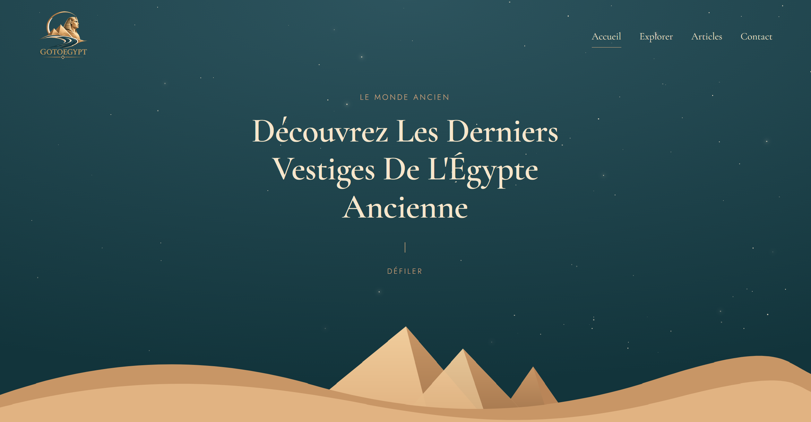

<div align="center">

# GOTOEGYPT

**Découvrez les derniers vestiges de l'Égypte ancienne.**

Site de voyages et de récits au coeur de l'Égypte ancienne.

[](https://nextjs.org/)
[](https://react.dev/)
[](https://developer.mozilla.org/fr/docs/Web/CSS)
[](https://goto-egypt.vercel.app)

[Voir le site](https://goto-egypt.vercel.app)

</div>

---

## Sommaire

- [À propos](#à-propos)
- [Aperçu](#aperçu)
- [Pages](#pages)
- [Stack technique](#stack-technique)
- [Installation](#installation)
- [Scripts](#scripts)
- [Structure du projet](#structure-du-projet)
- [Design](#design)
- [Déploiement](#déploiement)
- [Auteur](#auteur)

---

## À propos

**GOTOEGYPT** est un site vitrine immersif dédié à l'Égypte ancienne. Il présente la civilisation égyptienne, des articles sur son histoire et ses mythes, ainsi que des destinations à visiter : pyramides, temples, vallées et sites archéologiques.

Le site met l'accent sur l'ambiance : ciel étoilé animé, dunes en SVG, pyramides stylisées et palette de couleurs inspirée du désert.

## Aperçu

> Remplace ce bloc par une capture d'écran de ton site.

```md

```

## Pages

| Route       | Description                                                         |
| ----------- | ------------------------------------------------------------------- |
| `/`         | Accueil : hero animé, civilisation égyptienne, expériences, contact |
| `/explorer` | Les destinations et monuments à découvrir                           |
| `/articles` | Articles et récits sur l'Égypte ancienne                            |
| `/contact`  | Formulaire de contact et de réservation                             |

## Stack technique

| Outil                                                                      | Usage                              |
| -------------------------------------------------------------------------- | ---------------------------------- |
| [Next.js 16](https://nextjs.org/) (App Router, Turbopack)                  | Framework et routage               |
| [React 19](https://react.dev/)                                             | Interface                          |
| CSS natif (`globals.css`)                                                  | Styles, variables, responsive      |
| [`next/font`](https://nextjs.org/docs/app/api-reference/components/font)   | Polices Cormorant Garamond et Jost |
| [`next/image`](https://nextjs.org/docs/app/api-reference/components/image) | Optimisation des images            |

Aucune dépendance externe : uniquement `next`, `react` et `react-dom`.

## Installation

**Prérequis** : [Node.js](https://nodejs.org/) 20 ou supérieur.

```bash
# 1. Cloner le dépôt
git clone https://github.com/ton-pseudo/goto-egypt.git

# 2. Entrer dans le dossier
cd goto-egypt

# 3. Installer les dépendances
npm install

# 4. Lancer le serveur de développement
npm run dev
```

Le site est ensuite disponible sur [http://localhost:3000](http://localhost:3000).

## Scripts

| Commande        | Action                            |
| --------------- | --------------------------------- |
| `npm run dev`   | Lance le serveur de développement |
| `npm run build` | Génère la version de production   |
| `npm run start` | Lance la version de production    |

## Structure du projet

```text
goto-egypt/
├── app/
│   ├── articles/
│   │   └── page.js        # Page Articles
│   ├── contact/
│   │   └── page.js        # Page Contact
│   ├── explorer/
│   │   └── page.js        # Page Explorer
│   ├── favicon.ico
│   ├── globals.css        # Styles globaux et variables
│   ├── layout.js          # Layout racine (polices, header, footer)
│   └── page.js            # Page d'accueil
├── components/
│   ├── ContactForm.js     # Formulaire de contact
│   ├── Dunes.js           # Dunes et pyramides en SVG
│   ├── Footer.js          # Pied de page
│   ├── Header.js          # Navigation
│   ├── PageHero.js        # En-tête des pages internes
│   ├── ScrollTop.js       # Bouton retour en haut
│   └── Sky.js             # Ciel étoilé animé
├── public/                # Images (monuments, logo, etc.)
├── jsconfig.json          # Alias d'import (@/)
├── next.config.mjs        # Configuration Next.js
└── package.json
```

## Design

**Palette de couleurs**

| Nom        | Code      | Usage                 |
| ---------- | --------- | --------------------- |
| Sand       | `#E1B382` | Fond principal        |
| Sand dark  | `#A47C56` | Accents               |
| Night      | `#2D545E` | Sections sombres      |
| Night dark | `#12343B` | Texte                 |
| Cream      | `#F6E6CC` | Texte sur fond sombre |

**Typographie**

- Titres : [Cormorant Garamond](https://fonts.google.com/specimen/Cormorant+Garamond) (serif)
- Texte : [Jost](https://fonts.google.com/specimen/Jost) (sans-serif)

**Choix de conception**

- Tailles fluides avec `clamp()` pour un rendu adapté à tous les écrans
- Formes ondulées en SVG (`clipPath`) pour les photos et sections
- Focus clavier visible et attributs `aria` pour l'accessibilité
- Défilement fluide entre les sections

## Déploiement

Le site est conçu pour être déployé sur [Vercel](https://vercel.com).

1. Pousser le projet sur GitHub
2. Importer le dépôt sur [vercel.com/new](https://vercel.com/new)
3. Cliquer sur **Deploy**

Lien de production : [https://goto-egypt.vercel.app](https://goto-egypt.vercel.app)

## Auteur

**David R**

- GitHub : [@Dravix89](https://github.com/Dravix89)

---

<div align="center">

Fait avec soin pour les amoureux de l'Égypte ancienne.

</div>
